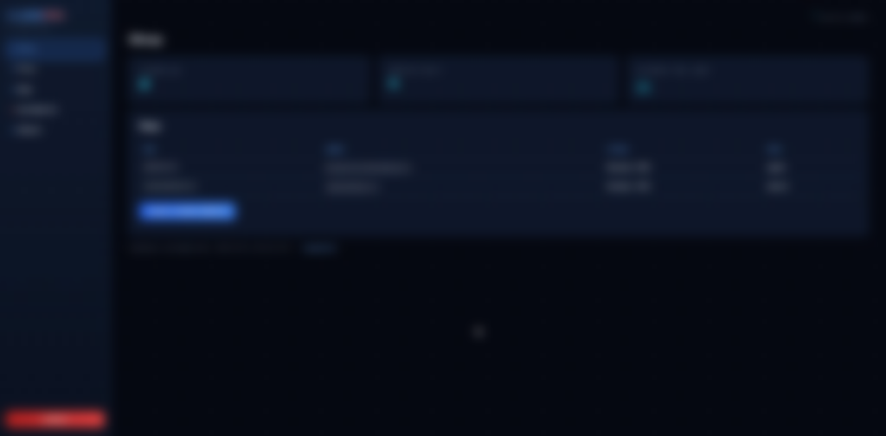
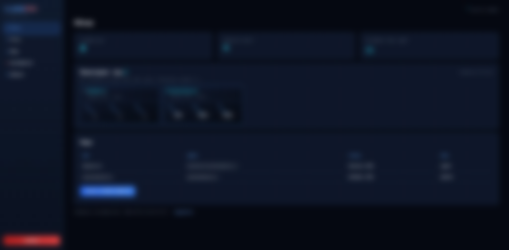
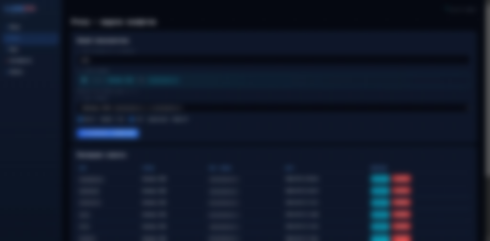
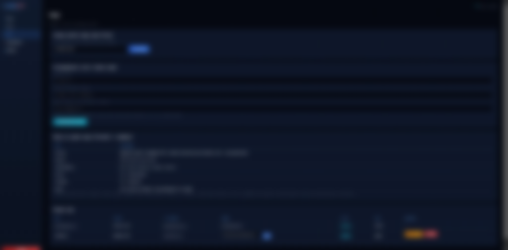
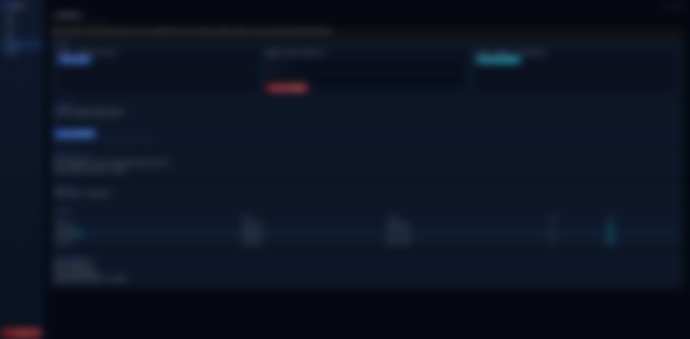
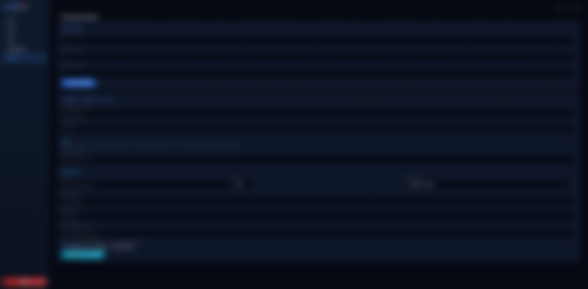

# VLESS Manager Pro

Платформа для развёртывания VPN на **Xray-core**: один универсальный профиль **VLESS + XHTTP через Cloudflare** (работает и на Wi‑Fi, и на мобильном интернете, обходит блокировки по IP), QR-коды, **web-панель**, **multi-node** через агентов, **systemd**, Let's Encrypt.

Репозиторий: [github.com/sweetpotatohack/vless-manager](https://github.com/sweetpotatohack/vless-manager)

---

## Web-панель (скриншоты)

Обезличенные кадры интерфейса **VLESSPRO** на master: HTTPS `:8765`, тёмная тема, единый вход для всех нод.

| Раздел | Описание |
|--------|----------|
| **Обзор** | Сводка, **мониторинг CPU/RAM/диск** по каждой ноде, выдача конфигов |
| **Proxy** | Создание пользователя, универсальный профиль + QR, список клиентов |
| **Ноды** | Master + remote agent, DNS VPN, порты firewall, install.sh |
| **Сертификаты** | Let's Encrypt, autoprenew, Hysteria2, certbot timer |
| **Кабинет** | Пароль admin, Telegram / SMTP оповещения |

### Обзор



### Мониторинг нод (CPU / RAM / диск)

Компактные датчики на master: отдельная карточка на каждую ноду (master + agent), обновление каждые 5 с.



### Proxy — выдача конфигов



### Ноды и agent



### Сертификаты



### Кабинет



---

## Быстрый старт (master-сервер)

### Что нужно заранее

| Требование | Зачем |
|------------|--------|
| VPS с **root** (Debian / Ubuntu) | Установка Xray, certbot, панели |
| Домен с **A-записью** на IP VPS | Let's Encrypt для VLESS и панели |
| Email для Let's Encrypt | Выпуск/продление сертификата |
| Открытые порты (см. ниже) | VPN + панель + certbot |
| **Git** на сервере | `git clone` репозитория |

**Порты на master (минимум):**

| Порт | Протокол | Назначение |
|------|----------|------------|
| **80/tcp** | HTTP | Выпуск/renew LE (standalone) |
| **8443/tcp** | TCP | origin для Cloudflare (xray-cf, универсальный профиль) |
| **8765/tcp** | HTTPS | Web-панель (основной вход) |
| **8766/tcp** | HTTP | Панель без TLS (если LE сломался) |
| 443/tcp · 25001/udp · 25000–45000/tcp | TCP/UDP | устаревшие прямые профили (REALITY / Hy2 / Wi‑Fi), для совместимости |

> Клиенту наружу открывается только стандартный **443/tcp** (Cloudflare edge). Порт `8443` — только для Cloudflare → origin, в клиентских ссылках не используется.

### Установка за 3 шага

```bash
git clone --depth 1 https://github.com/sweetpotatohack/vless-manager.git
cd vless-manager
chmod +x install_vless_manager.sh
sudo ./install_vless_manager.sh
```

При установке:

1. Укажите **домен** (например `vpn.example.com`) и **email** → certbot создаст LE → `/etc/vless-manager/tls.env`.
2. **Enter** без домена → самоподписанный TLS (в клиентах включите Allow Insecure).
3. Установщик поднимет **Xray**, **vless-xray.service**, **web-панель** (`vless-panel.service`).

Одной строкой:

```bash
git clone --depth 1 https://github.com/sweetpotatohack/vless-manager.git /tmp/vless-manager \
  && cd /tmp/vless-manager && chmod +x install_vless_manager.sh && sudo ./install_vless_manager.sh
```

### Первый вход и настройка

| Шаг | Действие |
|-----|----------|
| 1 | Откройте **`https://ВАШ_ДОМЕН:8765/login`** (или `http://IP:8766/login` — аварийный HTTP) |
| 2 | Логин **`admin`** / **`admin`** → сразу смените пароль в **Кабинет** |
| 3 | **Ноды** → укажите **страну** для локальной (master) ноды |
| 4 | **Сертификаты** → проверьте срок LE, при необходимости **Синхронизировать Hysteria** |
| 5 | **Cloudflare** → вставьте API-токен, сохраните, нажмите **«Подготовить домен»** |
| 6 | **Proxy** → создайте пользователя — один универсальный профиль + QR |

Полезные команды:

```bash
sudo systemctl enable --now vless-xray vless-panel
sudo systemctl status vless-panel vless-xray
/opt/vless-manager/vless_manager.sh cli create-wifi testuser
/usr/local/bin/vless-servers status
journalctl -u vless-panel -u vless-xray -f
```

---

## Что входит в проект

| Компонент | Назначение |
|-----------|------------|
| **`install_vless_manager.sh`** | Единая установка: Xray, TLS, firewall, sample-клиент, **web-панель**, systemd |
| **`vless_manager.sh`** | CLI/меню: универсальный Cloudflare профиль, QR, устаревшие Wi‑Fi/REALITY/Hy2 |
| **`vless-servers`** | Запуск/остановка inbound Xray по конфигам клиентов |
| **`panel/`** | Web **Control Panel** (FastAPI): Proxy, ноды, сертификаты, кабинет админа |
| **Агент на VPS** | Удалённая нода: тот же стек + API для master |

### Профиль клиента (универсальный)

Для каждого пользователя выдаётся **один универсальный профиль** — он работает и на Wi‑Fi, и на мобильном интернете:

| Профиль | Протокол | Порт клиента | Как работает |
|---------|----------|--------------|--------------|
| **Universal** | VLESS + XHTTP + TLS | 443/tcp | Клиент → Cloudflare:443 → сервер:8443 (xray-cf) |

```text
vless://UUID@vpn.ВАШ_ДОМЕН:443?encryption=none&security=tls&sni=vpn.ВАШ_ДОМЕН&fp=chrome&type=xhttp&path=%2Fws-akuma67&host=vpn.ВАШ_ДОМЕН#USER-cf
```

Плюс QR-код для импорта в v2rayN / v2rayTun. В клиенте: **MUX выключить**.

---

## Web Control Panel

### Разделы

| Вкладка | Функции |
|---------|---------|
| **Обзор** | Ноды, число клиентов, срок сертификатов |
| **Proxy** | Имя пользователя → **master-нода** → универсальный профиль + QR |
| **Cloudflare** | API-токен, зона, hostname, **«Подготовить домен»**, проверка origin |
| **Ноды** | Страна master, **генерация агента**, install-команда, статус online |
| **Сертификаты** | LE, renew, новый DNS, sync Hy2, автопродление |
| **Кабинет** | Пароль, Telegram / SMTP оповещения |

### Выдача конфига на master (локальная нода)

1. **Cloudflare** → API-токен + зона → **Сохранить** → **«Подготовить домен»**.
2. **Proxy** → имя (латиница, без пробелов) → нода **master**.
3. Нажмите **«Создать универсальный профиль + QR»** (~10–30 с).
4. Откройте карточку клиента — там `vless://` ссылка и QR.

Универсальный профиль выдаётся только на **master** (Cloudflare проксирует на origin master). Дубликаты имён на одной ноде запрещены.

---

## Multi-node: VPN с другого VPS через панель master

Схема: **одна web-панель** на главном сервере (master). Пользователи в **Proxy** выбирают **удалённую ноду** — master по API создаёт конфиг **на agent-VPS**, ссылки показываются в той же панели.

```
[Браузер] → https://master:8765 (Proxy)
                ↓ Bearer token
         [Agent VPS :8765] → vless_manager.sh cli → Xray inbound на agent
```

### Что нужно для agent-ноды

| Требование | Зачем |
|------------|--------|
| Отдельный VPS (root) | Xray + agent API |
| Свой домен / LE **или** общий стек TLS | Wi‑Fi VLESS на agent (при установке agent задаётся certbot как на master) |
| **Master должен достучаться до agent по TCP 8765** | `POST /api/v1/provision` с master на `api_base` ноды |
| Порты VPN на agent | 25000–45000/tcp, 443/tcp, 25001/udp (как на master) |

**На firewall agent:** разрешите **8765/tcp** с **IP master** (не обязательно открывать панель agent всему интернету).

**На master:** исходящие подключения к `IP_агента:8765` не блокировать.

### Подключение ноды через web (пошагово)

#### 1. На master: вкладка **Ноды**

1. Укажите **страну** для локальной ноды (если ещё не задана).
2. Блок **«Новый agent»**:
   - **Имя** — например `de-frankfurt`
   - **Страна** — отображается в Proxy (DE, NL, …)
   - **Домен** — опционально (для LE на agent; можно оставить пустым и указать при установке)
3. Нажмите **сгенерировать** — появится нода со статусом **pending** и команда установки.

#### 2. Скопируйте install-команду

Пример (URL master из панели **Ноды** → install-команда; подставьте свой домен и token):

```bash
curl -fsSL 'https://vpn.example.com:8765/api/v1/agent/install.sh?token=ВАШ_TOKEN' | bash
```

Используйте **HTTPS** URL master (домен из Let's Encrypt на master), не чужой хост из документации. Token одноразово привязан к записи ноды в БД.

Альтернатива: **Ноды** → скачать `install.sh` для конкретной ноды (если доступна кнопка/ссылка).

#### 3. На новом VPS (agent)

```bash
# от root — MASTER = ваш домен панели (как в tls.env), TOKEN из блока «Ноды»
curl -fsSL 'https://vpn.example.com:8765/api/v1/agent/install.sh?token=TOKEN' | bash
```

Скрипт:

- Скачивает **bundle** с master (`/api/v1/agent/bundle.tar.gz`)
- Запускает **`install_vless_manager.sh --remote-agent`**
- Поднимает **vless-xray**, **vless-panel** (API на :8765)
- Вызывает **`POST /api/v1/nodes/register`** на master (IP, domain, `api_base`)

#### 4. Проверка в панели

- **Ноды** → статус **online**, виден **public IP**
- С master: `curl -k https://IP_АГЕНТА:8765/api/v1/health` (или HTTP :8766)
- **Proxy** → в списке нод появится agent с нужной страной/IP

#### 5. Выдача VPN на удалённой ноде

Универсальный (Cloudflare) профиль выдаётся только на **master**. На remote-agent остаются прямые профили Wi‑Fi/LTE — их создают через API/CLI на самой ноде:

```bash
# на agent-ноде
/opt/vless-manager/vless_manager.sh cli create-wifi USER
/opt/vless-manager/vless_manager.sh cli create-mobile USER
```

Master синхронизирует их в каталог (**Proxy → Синхронизировать с нод**). VLESS-ссылки будут с **доменом/IP agent** и портом inbound на agent.

### Если нода не становится online

| Проблема | Решение |
|----------|---------|
| pending / offline | На agent: `systemctl status vless-panel`, `journalctl -u vless-panel -n 50` |
| `TypeError: Union ... received a 'tuple'` при install | На agent стоит **Python 3.14** — обновите **master** (SQLAlchemy ≥ 2.0.41 в bundle) и повторите `curl … install.sh`; либо на agent: `/opt/vless-manager/panel/venv/bin/pip install -U 'sqlalchemy>=2.0.41'` и `bash panel/install_panel.sh` из bundle |
| Master не создаёт конфиг | С master: `curl -H "Authorization: Bearer TOKEN" https://AGENT_IP:8765/api/v1/ports` |
| Firewall | Открыть 8765 с master → agent; VPN-порты для клиентов |
| Неверный `api_base` | В БД ноды должен быть URL agent API; перерегистрация через reinstall или правка в **Ноды** (если добавлено) / повтор install |
| Старый master URL | На agent: `/etc/vless-manager/panel/agent.env`, `master.url` — должен быть `https://master:8765` |

### Agent token

- На agent: `/etc/vless-manager/panel/agent.env` → `VLESS_PANEL_AGENT_TOKEN=...`
- Master хранит token в записи **Node** и шлёт `Authorization: Bearer ...` при provision/delete.
- Не публикуйте token; при утечке — сгенерируйте новую ноду в панели.

### Ручная установка agent (без curl install.sh)

```bash
export VLESS_PANEL_AGENT_TOKEN='token_с_master'
export VLESS_PANEL_MASTER_URL='https://master.example.com:8765'
sudo ./install_vless_manager.sh --remote-agent
# затем register вручную — см. API ниже
```

---

## Systemd (автозапуск)

| Служба | Описание |
|--------|----------|
| `vless-xray.service` | Все VLESS inbound из `/etc/vless-manager/clients/` |
| `xray-cf.service` | Универсальный профиль: VLESS + XHTTP на `:8443` (за Cloudflare) |
| `vless-panel.service` | HTTPS :8765 + HTTP fallback :8766, API агента |
| `vless-agent.service` | Alias той же unit (только на remote-нодах) |
| `xray-reality.service` | REALITY :443 (устаревший mobile) |
| `hysteria-server.service` | Hysteria2 :25001 (устаревший запасной) |

```bash
sudo systemctl enable --now vless-xray vless-panel
sudo systemctl restart vless-panel
/usr/local/bin/vless-servers reconcile   # поднять упавшие Wi‑Fi inbound
```

---

## CLI (`vless_manager.sh`)

```bash
vless-manager                    # интерактивное меню
/opt/vless-manager/vless_manager.sh cli create-cf USERNAME     # универсальный Cloudflare профиль
/opt/vless-manager/vless_manager.sh cli delete-cf USERNAME
/opt/vless-manager/vless_manager.sh cli ensure-cf              # поднять xray-cf
/opt/vless-manager/vless_manager.sh cli cf-status              # статус CF-обхода
# устаревшие прямые профили (для совместимости):
/opt/vless-manager/vless_manager.sh cli create-wifi USERNAME
/opt/vless-manager/vless_manager.sh cli create-mobile USERNAME
/opt/vless-manager/vless_manager.sh repair-ports
```

---

## Сертификаты

| Где | Путь / действие |
|-----|-----------------|
| LE live | `/etc/letsencrypt/live/DOMAIN/` |
| Активный VPN TLS | `/etc/vless-manager/tls.env` |
| Hysteria | `/etc/hysteria/certs/` (кнопка sync в панели) |
| Панель HTTPS | те же LE файлы из `tls.env` (uvicorn на :8765) |

Панель **Сертификаты**: продление, новый DNS, автопродление, оповещения в **Кабинет**.

---

## API агента (Bearer token)

| Метод | URL | Описание |
|-------|-----|----------|
| GET | `/api/v1/health` | Healthcheck |
| GET | `/api/v1/ports` | Порты и свободный Wi‑Fi слот |
| GET | `/api/v1/username-available` | Проверка имени перед provision |
| POST | `/api/v1/provision` | `{ "username", "wifi", "mobile" }` |
| POST | `/api/v1/delete` | Удаление конфига |
| POST | `/api/v1/nodes/register` | Регистрация agent (install.sh) |
| GET | `/api/v1/agent/install.sh?token=` | Bootstrap |
| GET | `/api/v1/agent/bundle.tar.gz?token=` | Архив для agent |

Заголовок: `Authorization: Bearer TOKEN`

---

## Файлы на сервере

```
/opt/vless-manager/
├── vless_manager.sh
├── install_vless_manager.sh
└── panel/
    ├── run_panel_dual.sh      # HTTPS + HTTP fallback
    └── ...

/etc/vless-manager/
├── tls.env
├── cf.env                     # hostname/path/port Cloudflare обхода
├── cf-clients/*.uuid          # клиенты универсального профиля
├── clients/*.json
├── urls/*.txt
├── qr-codes/*.png
├── mobile-reality/
└── panel/                     # panel.db, secret.key, agent.env

/usr/local/bin/vless-servers   # start | stop | reconcile
```

---

## Только web-панель (Xray уже есть)

```bash
cd vless-manager
sudo ./panel/install_panel.sh
```

---

## Обновление

**`/opt/vless-manager` обычно не git-репозиторий** — `git pull` там не сработает. Используйте скрипт (клонирует свежий код во `/tmp` и ставит в `/opt`):

```bash
sudo cp -a /etc/vless-manager /etc/vless-manager.backup.$(date +%F)
curl -fsSL https://raw.githubusercontent.com/sweetpotatohack/vless-manager/main/scripts/update_from_github.sh -o /tmp/vless-update.sh
sudo bash /tmp/vless-update.sh
```

Либо с уже скачанным репозиторием:

```bash
git clone --depth 1 https://github.com/sweetpotatohack/vless-manager.git /tmp/vless-manager-upd
sudo bash /tmp/vless-manager-upd/scripts/update_from_github.sh
```

**Не запускайте** `panel/install_panel.sh` напрямую из `/opt/vless-manager/panel/` — он считает «репо» = `/opt` и не подтянет новый код с GitHub (и раньше падал на `cp` в тот же файл).

Если разрабатываете в git-клоне на сервере:

```bash
sudo cp -a /etc/vless-manager /etc/vless-manager.backup.$(date +%F)
cd /path/to/vless-manager && git pull
sudo bash panel/install_panel.sh
sudo systemctl restart vless-xray vless-panel
```

---

## Переменные окружения (панель)

| Переменная | По умолчанию | Описание |
|------------|--------------|----------|
| `VLESS_PANEL_HTTPS_PORT` | 8765 | HTTPS панели |
| `VLESS_PANEL_HTTP_PORT` | 8766 | HTTP fallback |
| `VLESS_PANEL_MASTER_URL` | из tls.env | URL master для agent install |
| `VLESS_PANEL_AGENT_TOKEN` | random | Bearer на agent-ноде |
| `VLESS_PANEL_ROLE` | master / agent | Тип установки |
| `VLESS_TLS_ENV` | /etc/vless-manager/tls.env | LE для HTTPS панели |

---

## Безопасность

- Смените **admin** сразу; включите SMTP/Telegram в **Кабинет** для cert-alerts.
- Ограничьте **8766** по IP (аварийный HTTP); **8765** — HTTPS с LE.
- CSRF + rate limit на `/login`; пароли — bcrypt.
- Agent **8765** на remote: по возможности только с IP master.
- Не коммитьте `agent.env`, `tls.env`, PAT.

---

## Логи и отладка

```bash
journalctl -u vless-panel -u vless-xray -u hysteria-server -u xray-reality -f
ss -tulnp | egrep ':(443|8765|8766|25001|250[0-9]{2})'
curl -sSk https://127.0.0.1:8765/api/v1/health
curl -sS http://127.0.0.1:8766/api/v1/health
```

---

## Обход блокировок через Cloudflare (универсальный профиль)

Если провайдер/регион режет прямой доступ к IP сервера (SYN-пакеты не доходят), вход выносится за IP Cloudflare. Это и есть **универсальный профиль** для клиентов — один конфиг для Wi‑Fi и мобильного интернета.

```text
Клиент → Cloudflare:443 (TLS, SNI = vpn.<домен>) → сервер:8443 (VLESS + XHTTP + TLS)
```

### Автоматическая настройка (панель)

1. Перенесите NS домена на Cloudflare (у регистратора) и дождитесь статуса **Active**.
2. Cloudflare → **My Profile → API Tokens → Create Token** → шаблон **Edit zone DNS**, Zone Resources → Include → ваш домен.
3. В панели откройте **Cloudflare**:
   - вставьте API-токен;
   - зона = `ваш_домен` (например `astrainalog.ru`);
   - hostname = `vpn.ваш_домен` (подставляется сам), path `/ws-akuma67`, порт origin `8443`, SSL `Full`;
   - **Сохранить и поднять xray-cf**.
4. Нажмите **«Подготовить домен»** — панель через Cloudflare API создаст:
   - DNS `A vpn → IP сервера` с проксированием (оранжевое облако);
   - **Origin Rule**: `Hostname = vpn.<домен>` → destination port `8443`;
   - SSL/TLS режим `Full`.
5. Нажмите **«Проверить origin»**: HTTP `400/404/502/503` = Cloudflare достучался до origin; `521–524` = origin недоступен.

### Выдача клиенту

В **Proxy** создайте пользователя → кнопка **«Создать универсальный профиль + QR»**. В карточке клиента будет ссылка и QR:

```text
vless://UUID@vpn.ВАШ_ДОМЕН:443?encryption=none&security=tls&sni=vpn.ВАШ_ДОМЕН&fp=chrome&type=xhttp&path=%2Fws-akuma67&host=vpn.ВАШ_ДОМЕН#USER-cf
```

В v2rayN/v2rayTun: **MUX выключить**. Транспорт — **XHTTP** (современный, стабильно держит TCP и UDP, включая DNS).

### Ручная настройка (без панели)

Тот же результат дают команды CLI:

```bash
/opt/vless-manager/vless_manager.sh cli ensure-cf        # unit + ufw 8443 + конфиг xray-cf
/opt/vless-manager/vless_manager.sh cli create-cf USER   # клиент + ссылка + QR
```

А в Cloudflare вручную: запись `A vpn → IP` (proxied), **Origin Rule** `Hostname = vpn.<домен>` → порт `8443`, SSL-режим `Full`.

### Доступ к панели через Cloudflare

Если прямой IP тоже заблокирован, панель выносится за Cloudflare так же:

1. Cloudflare → DNS: запись `A panel → IP сервера`, проксирование включено.
2. **Rules → Origin Rules**: `Hostname = panel.<домен>` → destination port `8765`.
3. SSL/TLS режим `Full`.
4. Откройте `https://panel.<домен>` (это и есть web-панель).

На сервере порт `8765/tcp` должен быть открыт в ufw:

```bash
ufw allow 8765/tcp comment 'vless-panel-https'
```

> Порт `8766` (HTTP fallback без TLS) наружу не открывайте — только по SSH-туннелю при поломке сертификатов.

### Серверная часть (как это устроено)

- Конфиг `/etc/xray-cf/config.json` — VLESS + XHTTP + TLS, слушает `:8443`.
- Юнит `xray-cf.service` (systemd, автозапуск).
- Клиенты — `/etc/vless-manager/cf-clients/*.uuid`, конфиг пересобирается автоматически при создании/удалении.
- Сертификат — Let's Encrypt из `tls.env` (тот же, что для панели); режим `Full` не валидирует origin-сертификат.
- Firewall: `ufw allow 8443/tcp comment 'cloudflare-ws'`.

---

## Лицензия

См. [LICENSE](LICENSE). Автор CLI/форка: AKUMA0xDEAD; panel/multi-node — [sweetpotatohack/vless-manager](https://github.com/sweetpotatohack/vless-manager).
